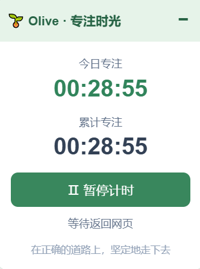
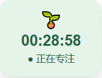

# 🌱 Olive · 专注时光

一个简单的浏览器专注计时用户脚本。通过 **暴力猴（Violentmonkey）**，可以在普通网页中运行自己编写的 JavaScript，为网页添加实用功能。本文以 Olive · 专注时光为例，介绍如何安装和运行用户脚本。

**当前版本：v1.0.0**

## ✨ 功能介绍

- **今日专注**：记录当天累计计时时长，按电脑本地日期在凌晨 00:00 切换到新的一天。
- **累计专注**：记录所有日期累计的计时时长。
- **暂停 / 继续**：按需控制计时。
- **展开 / 折叠**：折叠后仍能看到计时和状态。
- **自由拖拽**：展开和折叠状态均可拖动，并记住窗口位置。
- **本地保存**：保存计时记录和窗口状态。

## 🖼️ 运行效果

### 展开状态

显示今日专注、累计专注，以及暂停和继续计时按钮。



### 折叠状态

折叠后仍然显示专注时间和当前计时状态，并且可以自由拖拽。



## 📦 安装与使用

### 1. 安装暴力猴

在 Microsoft Edge 或 Google Chrome 的扩展商店搜索并安装 **Violentmonkey（暴力猴）**。安装后，可将其固定到浏览器工具栏。

### 2. 创建新脚本

点击浏览器右上角的 **暴力猴图标**，再点击 **「+」→「创建新脚本」**，进入脚本编辑页面。

### 3. 复制并粘贴代码

1. 打开仓库中的 [`olive-focus.user.js`](olive-focus.user.js)。
2. 点击 **Raw** 查看源代码，复制**全部内容**，包括顶部的 `// ==UserScript==` 配置。
3. 回到暴力猴编辑器，删除默认示例代码，粘贴复制的脚本。
4. 按 **Ctrl + S** 保存，确认脚本已启用。

### 4. 打开网页查看效果

打开一个普通网页（例如 https://www.baidu.com ），或刷新已经打开的网页，即可看到 **🌱 Olive · 专注时光**。

> 如果之前安装过旧版 Olive 脚本，请先禁用旧脚本，避免同一网页出现两个计时器。

## ⏰ 计时说明

- **今日专注**按本地自然日统计；跨过午夜后，在脚本下一次运行或更新时切换日期，重新统计当天时间。
- **累计专注**不会每天清零。
- **正在专注**表示当前处于计时状态，并不代表脚本能够识别你是否真的在学习。
- 计时主要依据网页可见性和焦点状态；关闭浏览器后不会继续计时，多标签页协调不能保证绝对精确。
- 数据保存在浏览器本地；清理扩展数据或卸载扩展可能导致记录丢失。

## ❓ 常见问题

**安装后没有显示？** 检查暴力猴和脚本是否启用，刷新普通网页，并确认扩展拥有相应网站的访问权限。浏览器内部页面（例如 `edge://extensions/` 和 `chrome://extensions/`）通常不支持注入此类脚本。

**需要单独安装软件吗？** 不需要。安装暴力猴扩展后，复制脚本即可运行。

**能在多台电脑间同步吗？** 当前版本主要使用浏览器本地存储，不提供跨设备自动同步。

## 📁 项目结构

```text
olive-focus/
├── README.md
├── olive-focus.user.js
└── images/
    ├── expanded.png
    └── collapsed.png
```

## 📄 说明

项目用于个人学习与日常时间记录。本文及部分代码借助 AI 辅助整理，如发现错误或有改进建议，欢迎交流。

项目地址：https://github.com/xiongziyao/olive-focus
